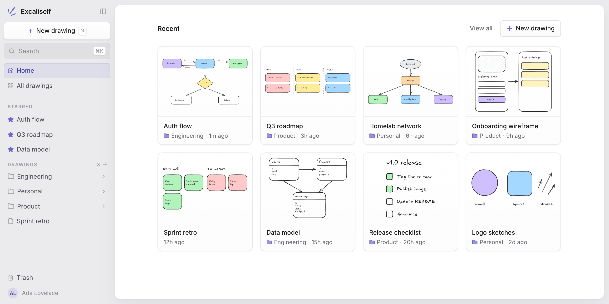

# Excaliself

Your team's whiteboard, on your server. Excaliself wraps the
[Excalidraw](https://excalidraw.com) canvas in a small self-hosted app: accounts,
folders, search, and a trash can, with every drawing stored in your own Postgres.

<picture>
  <source media="(prefers-color-scheme: dark)" srcset="docs/images/home-dark.png">
  
</picture>

## Features

- **The full Excalidraw editor**, with auto-save. Images pasted into a drawing are stored too.
- **Folders, stars, and recents.** Nest folders and drag drawings between them in the sidebar.
- **Command palette** (<kbd>⌘K</kbd> / <kbd>Ctrl K</kbd>) with fuzzy search over drawings, folders, and actions.
- **Trash** with restore. Deleted items are purged automatically after 30 days.
- **Invite-only accounts.** The first visitor creates the admin account; everyone else joins by invite link.
- **Admin tools** under Settings: manage members and roles, create password-reset links, and see instance stats.
- **Light and dark themes**, with an optional separate theme for the canvas.

## Deploy

Both paths run the app and its Postgres database together from one compose file.
The app applies database migrations when it starts, so updating is a redeploy.

### Docker Compose

Building the image from source needs about 4 GB of RAM.

```bash
git clone https://github.com/maciekzygmunt/selfhosted-excalidraw.git
cd selfhosted-excalidraw
cp .env.example .env   # set BETTER_AUTH_SECRET, POSTGRES_PASSWORD, and BASE_URL
docker compose up -d
```

Open `BASE_URL` (default <http://localhost:3000>). The first visit takes you to
`/setup` to create the admin account. Put a reverse proxy with HTTPS in front of
port 3000 for anything public.

### Coolify

1. Add a new resource from the public repository
   `https://github.com/maciekzygmunt/selfhosted-excalidraw`, branch `main`.
2. Choose the **Docker Compose** build pack and set **Docker Compose Location** to
   `/docker-compose.coolify.yaml`.
3. Click **Deploy**.

Coolify creates the database, generates the secrets, and assigns a domain, so
there is nothing to configure. Open the domain to create the admin account.
To pin a release instead of `latest`, set
`EXCALISELF_VERSION` (e.g. `1.0.0`) in the resource's environment variables.
Drawings live in the `pgdata` volume and survive redeploys.

### Configuration

| Variable | Required | Description |
|---|---|---|
| `BETTER_AUTH_SECRET` | Yes | Session signing secret, at least 32 characters |
| `BASE_URL` | Yes in production | Public URL of the instance (default `http://localhost:3000`) |
| `DATABASE_URL` | Yes | Postgres connection string (Docker Compose builds it for you) |
| `POSTGRES_PASSWORD` | Docker Compose | Password for the bundled Postgres |
| `POSTGRES_USER`, `POSTGRES_DB` | No | Bundled Postgres user and database (default `excaliself`) |

`GET /api/health` returns `200` when the app is up and can reach Postgres.

If the only admin loses their password, see
[break-glass recovery](./docs/break-glass-recovery.md).

## Stack

[TanStack Start](https://tanstack.com/start) · React 19 ·
[Better Auth](https://www.better-auth.com) · Postgres + [Drizzle](https://orm.drizzle.team) ·
Tailwind CSS 4 + shadcn/ui on [Base UI](https://base-ui.com) ·
[`@excalidraw/excalidraw`](https://github.com/excalidraw/excalidraw)

## Local development

Requires Node 22, pnpm, and Docker.

```bash
pnpm install
cp .env.example .env   # fill in the values; DATABASE_URL points at localhost
docker compose up -d db
pnpm dev               # http://localhost:3000
```

`pnpm test`, `pnpm typecheck`, and `pnpm lint` run the checks.
`pnpm db:generate` creates a migration after a schema change.

## License

[MIT](./LICENSE). There is no promise of support or reviews for contributions,
so feel free to fork it and make it yours.

Built on [Excalidraw](https://github.com/excalidraw/excalidraw), MIT © Excalidraw.
Excaliself is not affiliated with Excalidraw. "Excalidraw" is a trademark of
its owner; this project uses the open-source `@excalidraw/excalidraw` package.
