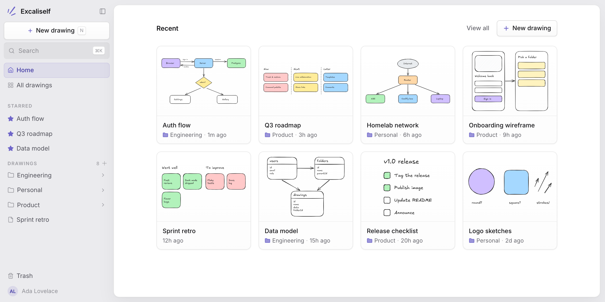
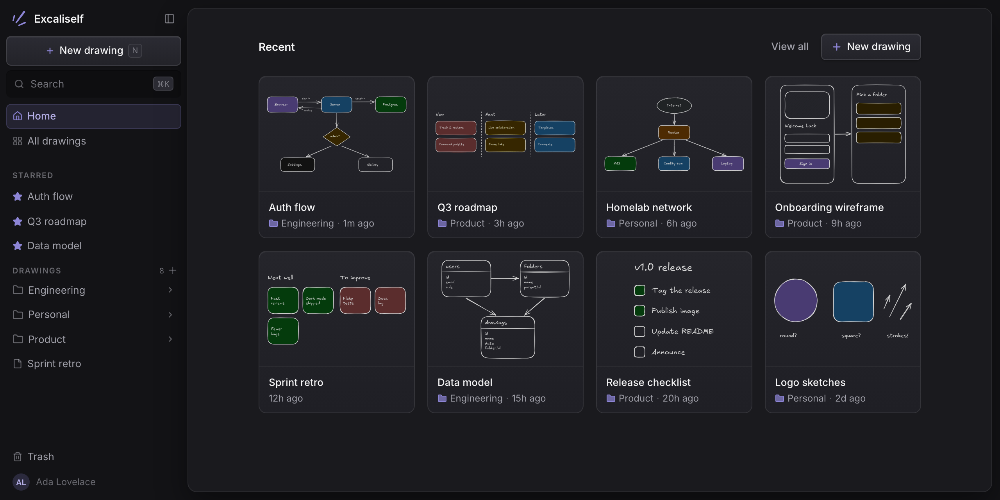
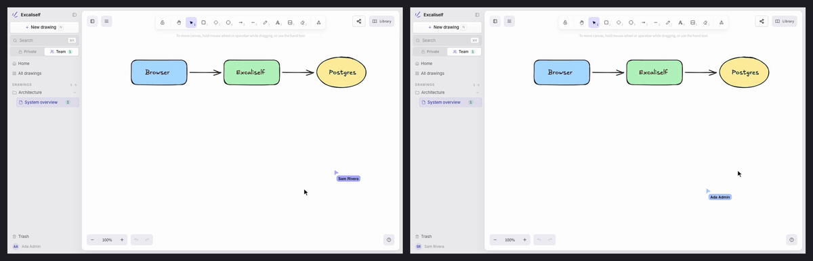

<p align="center">
  
</p>

<h1 align="center">Excaliself</h1>

<p align="center">
  部署在自有服务器上的团队白板。<br>
  Excaliself 是一款轻量的自托管应用，集成了 <a href="https://excalidraw.com">Excalidraw</a> 画布，支持实时协作、团队共享空间、文件夹管理和搜索。所有绘图都保存在你自己的 PostgreSQL 数据库中。
</p>

<p align="center">
  <a href="https://excaliself.com"><b>网站</b></a> ·
  <a href="https://excaliself.com/docs/"><b>英文文档</b></a> ·
  <a href="https://github.com/maciekzygmunt/excaliself/blob/main/README.md"><b>English README</b></a> ·
  <a href="https://x.com/0xzygmunt"><b>X</b></a>
</p>

> **本文由社区翻译和维护**，可能未及时跟进英文版本的更新。配置、部署和功能细节请以[英文 README](https://github.com/maciekzygmunt/excaliself/blob/main/README.md)及[英文文档](https://excaliself.com/docs/)为准。

<p align="center">
  
  
</p>

<p align="center">
  
</p>

## 10 秒快速体验

```bash
docker run --rm -p 127.0.0.1:3000:3000 -e PREVIEW_MODE=true ghcr.io/maciekzygmunt/excaliself
```

打开 [http://localhost:3000/preview/login](http://localhost:3000/preview/login)，即可使用管理员账号登录，查看预置的示例绘图。要试用实时协作，请在另一个浏览器中打开 [http://localhost:3000/preview/login?account=new](http://localhost:3000/preview/login?account=new)，即可使用一个新成员账号登录。

试用数据只保存在内存中，容器停止运行时数据将被清除。正式部署请参阅[部署](#部署)。

## 功能

- **完整的 Excalidraw 编辑功能**：绘图会自动保存，粘贴到画布中的图片也会一并保存。
- **实时协作**：通过链接分享绘图，即可多人同时编辑，查看彼此的光标位置，并使用跟随模式。分享链接既可以设为仅限成员访问，也可以向所有人开放，包括没有账号的访客。
- **团队空间**：每位成员都有自己的私人空间，也可以在所有成员均可查看和编辑的团队空间中协作。团队空间中的绘图始终开启实时协作。
- **团队素材库**：全体成员共用一个素材库面板，其中的图形和图标保存在服务器上，并实时同步更新。也可以从 [libraries.excalidraw.com](https://libraries.excalidraw.com) 安装素材库。
- **文件夹、收藏与最近使用**：支持在侧边栏中创建多级文件夹，通过拖放在文件夹之间移动绘图。
- **搜索**：可在绘图列表或命令面板（<kbd>⌘K</kbd> / <kbd>Ctrl K</kbd>）中搜索绘图标题和画布内的文字。命令面板还可用于执行操作。
- **从 Excalidraw+ 导入（测试版）**：使用 Excalidraw+ API 密钥导入绘图（场景）、集合和图片，入口为 Settings → Import（设置 → 导入）。
- **拖放文件导入**：把电脑上的 `.excalidraw` 文件，或内嵌绘图数据的 `.png` / `.svg` 导出文件，拖到侧边栏中的文件夹上。
- **回收站**：删除的内容可从回收站恢复，满 30 天后自动永久删除。
- **邀请制账号**：第一位访问者创建管理员账号，其他人通过邀请链接加入。
- **连接 AI 客户端**：Claude.ai、Claude Code、Claude Desktop 等 MCP 客户端可以查找、读取、创建和导出绘图，提议修改绘图，也可以把绘图移入回收站。修改提议会显示在画布上，只有你点击 Apply（应用）后才会生效，并实时同步给绘图中的所有人。客户端通过 OAuth 授权或个人访问令牌接入，Excaliself 无需配置大语言模型（LLM）的 API 密钥。
- **单点登录**：支持 Google Workspace、Microsoft Entra ID 和其他支持 OIDC 的身份服务（如 Okta、Authentik、Keycloak）。使用指定邮箱域名的用户可在首次登录时直接加入，无需邀请。
- **管理员工具**：在“设置”中管理成员和角色、创建密码重置链接，并查看实例统计信息。
- **浅色与深色主题**：还可以为画布单独设置主题。

## 部署

下面两种部署方式都会通过一份 Compose 配置同时启动应用和 PostgreSQL 数据库，并拉取预先构建好的镜像 `ghcr.io/maciekzygmunt/excaliself`（支持 amd64 和 arm64），无需在服务器上自行构建。`latest` 标签对应最新发布版本。应用会在启动时自动执行数据库迁移，更新时拉取新镜像并重新部署即可。

### Docker Compose

```bash
mkdir excaliself && cd excaliself
curl -fsSLO https://raw.githubusercontent.com/maciekzygmunt/excaliself/main/docker-compose.yaml
curl -fsSL -o .env https://raw.githubusercontent.com/maciekzygmunt/excaliself/main/.env.example
# 在 .env 中设置 POSTGRES_PASSWORD、BETTER_AUTH_SECRET 和 BASE_URL
docker compose up -d
```

访问 `BASE_URL` 指定的地址（默认 [http://localhost:3000](http://localhost:3000)）。首次访问时，应用会引导你前往 `/setup` 创建管理员账号。PostgreSQL 的端口不会映射到宿主机。如需通过公网访问应用，请配置反向代理，通过 HTTPS 将请求转发到应用的 3000 端口。

更新时运行 `docker compose pull && docker compose up -d`。如需使用固定版本，在 `.env` 中设置 `EXCALISELF_VERSION`（例如 `1.0.0`）。若要从源码构建镜像（大约需要 4 GB 内存），请克隆仓库并运行 `docker compose -f docker-compose.yaml -f docker-compose.build.yaml up -d --build`。详情参阅[英文部署文档](https://excaliself.com/docs/docker-compose/)。

### Coolify

1. 通过公开仓库 `https://github.com/maciekzygmunt/excaliself` 创建新资源，使用 `main` 分支。
2. 选择 **Docker Compose** 构建方式，将 **Docker Compose Location** 设为 `/docker-compose.coolify.yaml`。
3. 点击 **Deploy**（部署）。

Coolify 会创建数据库、生成密钥并分配域名，因此不需要额外配置。如果服务器尚未配置通配符域名，请先为 `excaliself` 服务配置域名，并在地址中注明容器端口，例如 `https://draw.example.com:3000`。访问该地址后即可创建管理员账号。若要使用指定版本而不是 `latest`，请在资源的环境变量中设置 `EXCALISELF_VERSION`（例如 `1.0.0`）。绘图保存在 `pgdata` 数据卷中，重新部署后仍会保留。

### 配置

使用 Docker Compose 时，以下环境变量从 `.env` 文件读取；使用 Coolify 时，由 Coolify 自动设置。

| 变量                                                               | 是否必需                         | 说明                                                                                                                                                                                                                                                                                                                                                                                                    |
| ------------------------------------------------------------------ | -------------------------------- | ------------------------------------------------------------------------------------------------------------------------------------------------------------------------------------------------------------------------------------------------------------------------------------------------------------------------------------------------------------------------------------------------------- |
| `POSTGRES_PASSWORD`                                              | 是                               | 配套 PostgreSQL 数据库的密码。密码会写入数据库连接 URL，请使用十六进制字符串（可运行 `openssl rand -hex 24` 生成）                                                                                                                                                                                                                                                                                    |
| `BETTER_AUTH_SECRET`                                             | 是                               | 用于会话签名的密钥，长度至少为 32 个字符（`openssl rand -base64 32`）                                                                                                                                                                                                                                                                                                                                 |
| `BASE_URL`                                                       | 生产环境必需                     | 应用的对外访问地址（默认 `http://localhost:3000`）                                                                                                                                                                                                                                                                                                                                                    |
| `EXCALISELF_VERSION`                                             | 否                               | 镜像标签：默认 `latest`，也可使用 `1.0.0`、`1.0` 或 `main` 等标签                                                                                                                                                                                                                                                                                                                               |
| `EXCALISELF_PORT`                                                | 否                               | 应用在宿主机上的监听端口，默认为 `3000`。设为 `127.0.0.1:3000` 可限制为仅本机可访问，供本机反向代理转发请求                                                                                                                                                                                                                                                                                         |
| `POSTGRES_USER`、`POSTGRES_DB`                                 | 否                               | 配套 PostgreSQL 数据库的用户名和数据库名，默认均为 `excaliself`                                                                                                                                                                                                                                                                                                                                       |
| `GOOGLE_*`、`MICROSOFT_*`、`OIDC_*`、`SSO_ALLOWED_DOMAINS` | 否                               | 单点登录配置，参阅[英文单点登录文档](https://excaliself.com/docs/single-sign-on/)                                                                                                                                                                                                                                                                                                                        |
| `PREVIEW_MODE`                                                   | 否                               | 设为 `true` 时启动用于预览拉取请求（PR）的临时环境，使用内存中的 PGlite 代替 PostgreSQL，并预置管理员账号和示例绘图。该模式不使用 `DATABASE_URL` 和 `BASE_URL`，`BETTER_AUTH_SECRET` 可以省略。`/preview/login` 以管理员身份登录（`admin@example.com` / `preview-password`）；`/preview/login?account=new` 以新成员身份登录。重启后数据会丢失。参阅 [PR 预览说明](./docs/pr-previews.md) |
| `PREVIEW_HOSTS`                                                  | 使用预览模式且通过域名访问时必需 | 预览环境允许访问的主机名，多个值以逗号分隔，例如 `*.draw.example.com`。使用其他主机名访问时无法通过身份验证；`localhost` 始终允许访问                                                                                                                                                                                                                                                               |

应用正常运行且能连接 PostgreSQL 时，`GET /api/health` 会返回 `200`。

如果只有一个管理员账号，而该账号的密码已遗失，请参阅[英文管理员账号恢复说明](https://excaliself.com/docs/admin-recovery/)。

## 连接 AI 客户端（MCP）

Excaliself 在 `/api/mcp` 提供 [MCP（模型上下文协议）](https://modelcontextprotocol.io) 服务。模型调用由 AI 客户端负责，因此 Excaliself 无需配置大语言模型的 API 密钥。

**Claude.ai**（网页版、桌面版和移动版）通过 OAuth 授权连接，无需手动配置访问令牌。在 Claude 中打开 **Settings → Connectors**（设置 → 连接器），点击 **Add custom connector**（添加自定义连接器），填入 `https://<你的实例地址>/api/mcp`，然后登录 Excaliself 并点击 **Allow**（允许）。你的 Excaliself 实例必须能通过公网 HTTPS 访问。

其他客户端可使用访问令牌：

1. 在 Excaliself 中打开 **Settings → MCP**（设置 → MCP），点击 **New token**（新建令牌）。令牌只会显示一次，请及时复制并保存。
2. 在 AI 客户端中添加 MCP 服务，填入你的 Excaliself 实例地址和令牌。

**Claude Code**（令牌对话框会提供已填好地址和令牌的命令）：

```bash
claude mcp add --transport http excaliself https://draw.example.com/api/mcp \
  --header "Authorization: Bearer exs_..."
```

**Claude Desktop** 本身无法直接向远程服务器发送令牌，因此需要通过 [`mcp-remote`](https://www.npmjs.com/package/mcp-remote) 连接；使用它需要先安装 Node.js。打开 **Settings → Developer → Edit Config**（设置 → 开发者 → 编辑配置），在 `claude_desktop_config.json` 中加入以下内容，然后重启 Claude Desktop：

```json
{
  "mcpServers": {
    "excaliself": {
      "command": "npx",
      "args": [
        "-y",
        "mcp-remote",
        "https://draw.example.com/api/mcp",
        "--header",
        "Authorization:${AUTH_HEADER}"
      ],
      "env": { "AUTH_HEADER": "Bearer exs_..." }
    }
  }
}
```

**其他支持 Streamable HTTP 的客户端**，连接地址为 `https://<你的实例地址>/api/mcp`。如果客户端支持 OAuth 动态客户端注册，即可通过 OAuth 登录；否则需在请求中添加 `Authorization: Bearer <token>` 请求头。

可用工具包括：

- `list_drawings`、`search_drawings` 和 `list_folders`：查找绘图与文件夹，并显示它们所属的空间和文件夹。
- `read_drawing`：描述绘图中的形状、文字及箭头连接关系；不会返回原始 Excalidraw JSON。
- `export_drawing`：把绘图导出为 PNG 或 SVG 图片，例如用于文档。SVG 内嵌绘图所用的字体。`export_scene` 把绘图导出为 `.excalidraw` 文件。
- `create_drawing`：使用简单的形状和箭头，或 Mermaid 流程图，在私人空间或团队空间中创建绘图，也可指定存入某个文件夹。
- `edit_drawing`：提议修改绘图，可以添加、修改或删除形状、文字和箭头。只有你在绘图上点击 **Apply**（应用）后，修改才会生效；`get_drawing_edit` 告诉客户端你是否已应用。
- `create_folder`：在私人空间或团队空间创建文件夹，也可以放在另一个文件夹内。
- `move_drawing`：把绘图移入文件夹，或移到所属空间的根目录；不能在私人空间与团队空间之间移动绘图。
- `trash_drawing` 和 `trash_folder`：把绘图或文件夹及其中全部内容移入回收站；`restore_drawing` 和 `restore_folder` 可将其恢复。

通过令牌或已授权应用发起的操作，使用的都是你的账号权限：可以查看你有权查看的内容，将你有权移入回收站的内容移入回收站，创建绘图和文件夹，以及在文件夹之间移动绘图。在你点击 **Apply**（应用）之前，这些客户端不能修改已有绘图的内容；它们也不能永久删除内容；移入回收站的内容会保留 30 天。你可以随时在“设置”中撤销令牌或断开应用连接。管理员删除成员时，该成员的令牌和应用连接也会失效。

## 技术栈

[TanStack Start](https://tanstack.com/start) · React 19 ·
[Better Auth](https://www.better-auth.com) · PostgreSQL + [Drizzle](https://orm.drizzle.team) ·
Tailwind CSS 4 + 基于 [Base UI](https://base-ui.com) 的 shadcn/ui ·
[`@excalidraw/excalidraw`](https://github.com/excalidraw/excalidraw)

## 本地开发

需要 Node.js 22、pnpm 和 Docker。

```bash
pnpm install
cp .env.dev.example .env                           # 可直接使用
docker compose -f docker-compose.dev.yaml up -d    # PostgreSQL 监听 127.0.0.1:5432
pnpm dev                                           # http://localhost:3000
```

`pnpm dev:preview` 不需要 PostgreSQL 或 `.env`；它会以预览模式运行（参阅上文的 `PREVIEW_MODE`）。打开 `/preview/login` 即可登录。

`pnpm test`、`pnpm typecheck` 和 `pnpm lint` 用于运行检查。修改数据库结构后，用 `pnpm db:generate` 生成迁移文件。项目通过 Git 标签发布版本；参阅[英文发布说明](./docs/releasing.md)。

## 赞助

Excaliself 是免费软件，采用 MIT 许可证。如果你的团队在使用它，可以通过[赞助项目](https://github.com/sponsors/maciekzygmunt)支持维护者修复问题和发布新版本。

## 许可证

[MIT](./LICENSE)。维护者不承诺提供技术支持，也不保证审查提交的贡献。你可以自由 fork 本项目，按自己的需求修改和使用。

项目基于 [Excalidraw](https://github.com/excalidraw/excalidraw) 构建，其许可证同为 MIT，© Excalidraw。Excaliself 与 Excalidraw 无隶属或关联关系。“Excalidraw”是其所有者的商标；本项目使用开源的 `@excalidraw/excalidraw` 软件包。
