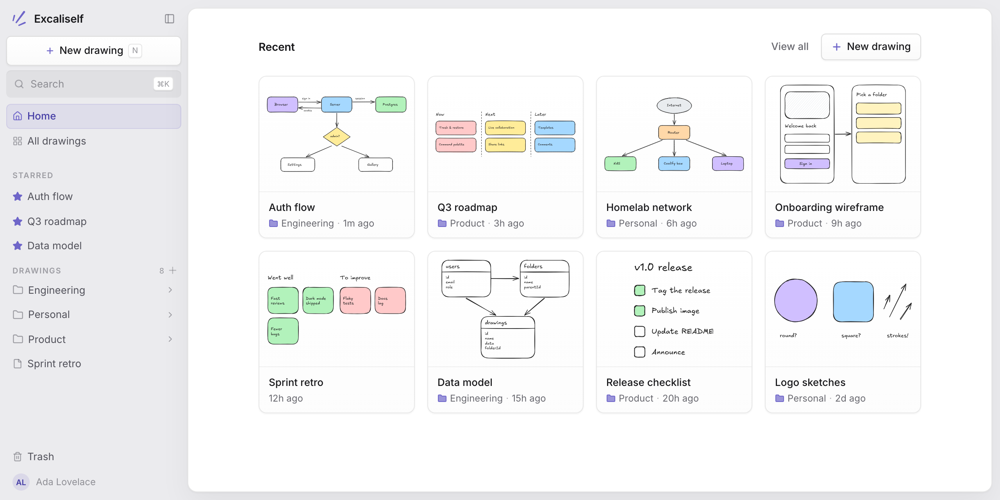

# Excaliself

Your team's whiteboard, on your server. Excaliself is a self-hosted, open-source
alternative to Excalidraw+: the full Excalidraw editor with accounts, single
sign-on, folders, search, live collaboration, a shared team space, and an MCP
server for AI clients. MIT licensed, multi-arch (amd64 and arm64).

- Docs: <https://excaliself.com/docs/>
- Source and issues: <https://github.com/maciekzygmunt/excaliself>



## Try it in 10 seconds

```bash
docker run --rm -p 127.0.0.1:3000:3000 -e PREVIEW_MODE=true maciekzygmunt/excaliself
```

Open <http://localhost:3000/preview/login> to sign in as the admin, with example
drawings. Data lives in memory and is gone when the container stops.

## Quick start with Docker Compose

The app needs PostgreSQL. The compose file starts both.

```bash
mkdir excaliself && cd excaliself
curl -fsSLO https://raw.githubusercontent.com/maciekzygmunt/excaliself/main/docker-compose.yaml
curl -fsSL -o .env https://raw.githubusercontent.com/maciekzygmunt/excaliself/main/.env.example
# set POSTGRES_PASSWORD, BETTER_AUTH_SECRET, and BASE_URL in .env
docker compose up -d
```

Open `BASE_URL` (default <http://localhost:3000>). The first visit takes you to
`/setup` to create the admin account. Put a reverse proxy with HTTPS in front
of port 3000 for anything public. See the
[Docker Compose docs](https://excaliself.com/docs/docker-compose/) for proxy
setup, upgrades, and backups.

The compose file pulls the same image from `ghcr.io/maciekzygmunt/excaliself`.
To pull from Docker Hub instead, change its `image:` line to
`maciekzygmunt/excaliself:${EXCALISELF_VERSION:-latest}`.

## Tags

| Tag | Tracks |
|---|---|
| `latest` | Newest release |
| `1.2.3` | That exact release |
| `1.2` | Newest `1.2.x` patch |
| `main` | Tip of `main` (unreleased, may break) |

The app applies database migrations when it starts, so upgrading is pulling a
newer image and restarting.

## Environment variables

| Variable | Required | Description |
|---|---|---|
| `DATABASE_URL` | Yes | PostgreSQL connection URL. The compose file builds it from `POSTGRES_*` |
| `BETTER_AUTH_SECRET` | Yes | Session signing secret, at least 32 characters (`openssl rand -base64 32`) |
| `BASE_URL` | Yes in production | Public URL of the instance (default `http://localhost:3000`) |
| `GOOGLE_*`, `MICROSOFT_*`, `OIDC_*`, `SSO_ALLOWED_DOMAINS` | No | [Single sign-on](https://excaliself.com/docs/single-sign-on/) |
| `PREVIEW_MODE` | No | `true` runs a throwaway instance on an in-memory database, seeded with example drawings |

The compose file also reads `POSTGRES_PASSWORD`, `EXCALISELF_VERSION`, and
`EXCALISELF_PORT` from `.env`. See
[Environment variables](https://excaliself.com/docs/environment/) for every
setting.

`GET /api/health` returns `200` when the app is up and can reach Postgres. The
image uses it as its container healthcheck.
