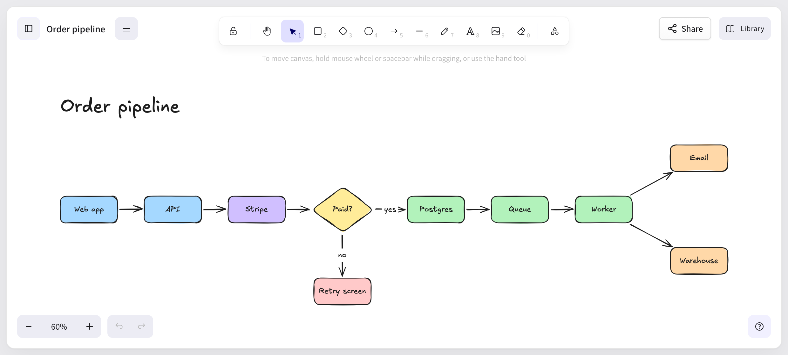

Excaliself has an [MCP](https://modelcontextprotocol.io) server. Once you connect Claude to it, you can ask for a diagram in plain words and get back a real Excalidraw drawing on your own server, in your own database, that you and your team can open and edit.

Your AI client brings the model, so your instance needs **no LLM API key**, and no drawing data goes to a third-party whiteboard service.



That diagram was drawn by Claude Code over MCP from one prompt. In this tutorial you will get the same thing working.

## What you need

- A running Excaliself instance you can sign in to. If you do not have one, deploy it in a few minutes with [Docker Compose](/docs/docker-compose/) or [Coolify](/docs/coolify/).
- [Claude Code](https://claude.com/claude-code), or Claude Desktop (which also needs Node).

## 1. Make an access token

1. In Excaliself, open **Settings**, then **MCP**.
2. Click **New token** and copy it. You see it only once.

The token acts as you: it sees what you see. You can revoke it under **Settings** at any time.

## 2. Connect your client

### Claude Code

The token dialog shows this command with your URL and token filled in:

```bash
claude mcp add --transport http excaliself https://draw.example.com/api/mcp \
  --header "Authorization: Bearer exs_..."
```

### Claude Desktop

Claude Desktop cannot send a token to a remote server itself, so it connects through [`mcp-remote`](https://www.npmjs.com/package/mcp-remote). Open **Settings**, then **Developer**, then **Edit Config**, add this to `claude_desktop_config.json`, and restart Claude Desktop:

```json
{
  "mcpServers": {
    "excaliself": {
      "command": "npx",
      "args": [
        "-y",
        "mcp-remote",
        "https://draw.example.com/api/mcp",
        "--header",
        "Authorization:${AUTH_HEADER}"
      ],
      "env": { "AUTH_HEADER": "Bearer exs_..." }
    }
  }
}
```

Replace `draw.example.com` with your instance's address and `exs_...` with your token. Other clients that speak Streamable HTTP work too: use `https://<your instance>/api/mcp` and the header `Authorization: Bearer <token>`.

## 3. Ask for a diagram

Start your client and try:

> Draw the order pipeline of a web shop in Excaliself, left to right: web app, API, Stripe, then a "Paid?" decision. If yes, it goes to Postgres, then a queue, then a worker that sends an email and updates the warehouse. If no, it goes to a retry screen. Put it in the Team space.

Claude calls the `create_drawing` tool and answers with a link. Open it and the diagram is there, on the canvas, as normal Excalidraw shapes and arrows. Move things, recolor them, or invite a teammate to edit it live.

`create_drawing` takes simple shapes and arrows, or a Mermaid flowchart, and lays them out for you. It puts the drawing in your private space or in Team, optionally in a folder.

## 4. Ask about the drawings you already have

Claude can also look things up:

> Find my drawings about checkout and tell me what the Stripe step connects to.

Behind that are `search_drawings` and `read_drawing`. `read_drawing` returns a description of the drawing (its shapes, text, and what the arrows connect), not the raw Excalidraw JSON. The full tool list is in the [MCP docs](/docs/mcp/): `list_drawings`, `search_drawings`, `list_folders`, `read_drawing`, and `create_drawing`.

## What it can't do

Be clear about the limits before you rely on it:

- It **creates new drawings only**. It cannot change or delete drawings that exist, so a bad prompt cannot damage your work.
- `create_drawing` supports Mermaid **flowcharts** only, not other Mermaid diagram types.
- If an admin deletes a member, that member's tokens stop working.
- If a member later signs in with SSO for the first time and their account links by email, their tokens are revoked. Make a new one.

## Try it

If you try this, a bug report or a diagram prompt that went wrong is the most useful thing you can send. Open an [issue on GitHub](https://github.com/maciekzygmunt/excaliself/issues).
